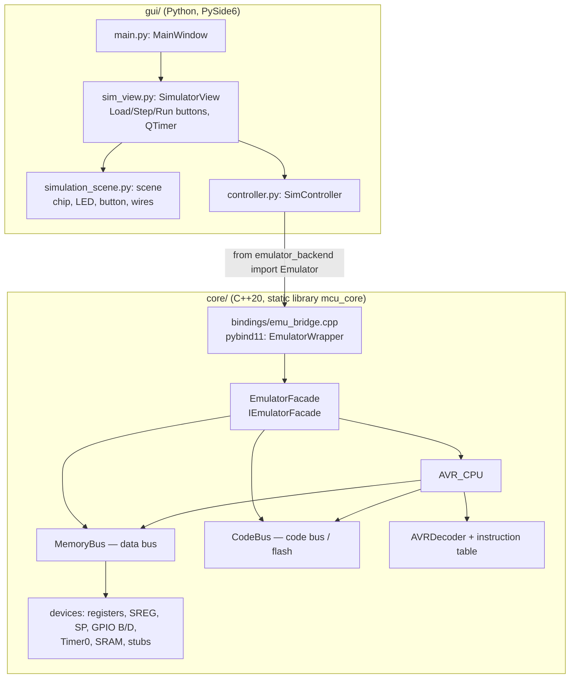
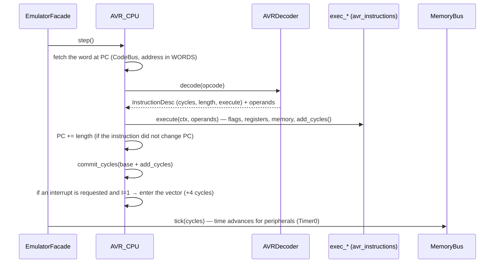

# Architecture

The project is an ATmega328P emulator: a C++ core (`core/`), a Python/PySide6 GUI (`gui/`) and C++ core tests
(`tests/cpp/`).

## Layers



- The **GUI** contains no emulation logic: all state is read through `emulator_backend.Emulator`
  (`step`, `run`, `read_memory`, `get_registers`, …).
- **`EmulatorFacade`** is the only entry point into the core: it owns the CPU, buses and devices and implements
  `step_instruction`, `run_for_cycles`, `read/write_data`, flash loading and reset.
- **`ATmega328P::create()`** assembles a concrete MCU (memory, I/O map, peripherals, decoder).
  To get a different MCU, write a new assembly class; the core (`AVR_CPU`) is reused.

## `core/` directory map

| Directory                 | Contents                                                                                                                                                                                                                      |
| ------------------------- | ----------------------------------------------------------------------------------------------------------------------------------------------------------------------------------------------------------------------------- |
| `interfaces/Interfaces.h` | all interfaces: `IMemoryMapped`, `ITickable`, `IResettable`, `ICPU`, `IDataBus`, `ICodeBus`, `IInterruptSink`, `IEmulatorFacade`                                                                                              |
| `cpu/`                    | `AVR_CPU` (fetch→decode→execute loop, stack, interrupts), `avr_instructions.*` (instruction semantics), `avre_plus_instruction_table.cpp` (mask/pattern table), `AVRExecutionContext.h` (a narrow interface for instructions) |
| `disasm/`                 | `avr::disassemble` — instruction text (objdump-style aliases, jump targets as byte addresses)                                                                                                                                 |
| `decoder/`                | `AVRDecoder` (a lookup over the 16-bit opcode) and `decode_*` — operand decoding                                                                                                                                              |
| `bus/`                    | `MemoryBus` (address range → device, ticks peripherals), `CodeBus`, `FlashDevice`, `SRAMDevice`                                                                                                                               |
| `mcu/avr/`                | `ATmega328P` (MCU assembly), constants (vectors), `AVR_GPIO`                                                                                                                                                                  |
| `mcu/peripherals/`        | `Timer0`, `MMIORegister`, `UnimplementedIODevice`, the register file, SREG, SP, `Wire`                                                                                                                                        |
| `hex_parser/`, `loader/`  | Intel HEX → `HexImage` → `ProgramImage` (flash/EEPROM)                                                                                                                                                                        |
| `facade/`                 | `EmulatorFacade`                                                                                                                                                                                                              |
| `bindings/`               | the pybind11 module `emulator_backend`                                                                                                                                                                                        |

## The path of one instruction



The main timing rule: **cycles are counted in one place** (`AVR_CPU::commit_cycles`), and exactly that number is
passed to `MemoryBus::tick`. Instructions with a variable cost (a taken branch, a skip) call
`ctx.cpu().add_cycles(n)`.

## Data bus and address map

Addresses are those of the ATmega328P data space:

| Range                       | What                                                                  |
| --------------------------- | --------------------------------------------------------------------- |
| `0x00–0x1F`                 | registers R0–R31                                                      |
| `0x20–0xFF`                 | I/O (by default `UnimplementedIODevice`: reads 0, writes are ignored) |
| `0x23–0x25`, `0x29–0x2B`    | GPIOB / GPIOD (PIN, DDR, PORT)                                        |
| `0x35`, `0x44–0x48`, `0x6E` | Timer0: TIFR0, TCCR0A/B, TCNT0, OCR0A/B, TIMSK0                       |
| `0x3F`, `0x41–0x42`         | EEPROM (stubs)                                                        |
| `0x5D–0x5E`, `0x5F`         | SPL/SPH (a proxy to the CPU's SP), SREG                               |
| `0x100–0x8FF`               | SRAM (2 KiB)                                                          |

Any other address outside the map throws `MemoryAccessError`. The map is defined in
`ATmega328P::build_memory_map`. Timer0 registers are scattered, so each one is a separate `MMIORegister` at its
own address, while `Timer0` itself receives time separately (`MemoryBus::add_tickable`).

## Interrupts

- A peripheral (Timer0) holds the request _level_: `flag & mask` → `IInterruptSink::raise/clear_interrupt(vector)`.
- The CPU keeps a set of pending vectors; the **lowest vector address** wins (higher priority).
- Entry: push PC onto the stack, clear I, jump to the vector, hardware flag clearing (ack handler), +4 cycles.
- After `SEI`/`RETI` the next instruction executes before an interrupt is taken.
- `SLEEP`: the CPU stands still (1 cycle per step), peripherals keep running, a pending interrupt wakes it up.

## Loading a HEX file

```
.hex file → HexParser::parse → HexImage (address → bytes)
          → AVRProgramLoader::load (layout: 32 KiB flash / 1 KiB EEPROM) → ProgramImage
          → EmulatorFacade::load_flash_bytes → FlashDevice
```

Parsing rules: whitespace/CRLF at the ends of a line and empty lines are allowed; record types 00–05 are
supported (`02` — segment × 16, `04` — the upper 16 address bits); any error is a `HexFormatError` with the line
number and the reason (no `:`, an odd number of digits, a non-hex character, length not matching the byte count,
checksum). `avr-objcopy` places flash at `0x000000` and EEPROM at `0x810000`; the loader skips fuse/lock data
(`0x82xxxx`…) and reports it in `ProgramImage::warnings` (in Python — the list returned by `load_hex`).
EEPROM is not emulated yet — EEPROM data from a HEX file is dropped with a warning.

Flash is a byte array, but the CPU accesses it by **words** (`CodeBus::read_word(word_addr)`).
More about the units in [glossary.md](glossary.md).

## Include paths

Headers are included **from the root of `core/`**: `#include "cpu/AVR_CPU.h"`, `#include "common/errors.h"` — no
`../`. The root is added in `target_include_directories(mcu_core PUBLIC …)`, so tests (`tests/cpp`) and the
bindings use the same form. A new header `core/<dir>/x.h` is immediately available as `"<dir>/x.h"`.

## Python module API (`emulator_backend`)

Type stubs: `gui/stubs/emulator_backend.pyi`.

- Running: `step()`, `run(cycles)` (returns the cycles executed), `reset()`; `run()` **releases the GIL**, so it
  can be called from a worker thread. `stop()` (thread-safe) asks a running `run()` to return after the current
  instruction; `is_running()`. While `run()` is active, the other methods throw `EmulatorBusyError`.
- Disassembler: `disassemble(word_addr, count)` → `[{addr, size, words, text, known}]`.
- State: `snapshot()` (pc, sp, sreg, cycles, registers in one call), `read_memory_block`,
  `read_flash`, `get_memory_map()` (data-space regions).
- Errors (all inherit `EmulatorError`): `IllegalInstructionError` (with the opcode and address),
  `HexFormatError`, `MemoryAccessError`, `EmulatorBusyError`.

## GUI (overview)

- `main.py` — the main window with tabs; the working part is the "Simulator" tab (`sim_view.py`).
- `sim_view.py` — Load/Step/Run/Reset buttons; Run executes batches of cycles by the MCU clock (`run_pacing.py`).
- `simulation_scene.py` — the graphics scene: the chip (`chip_item.py`), the LED and button
  (`interactive_items.py`), wires (`wire_item.py`). Pin state is read from `DDRx/PORTx`; an LED lights up when
  connected to an output pin that is high. The button does not affect the emulator yet (see [status.md](status.md)).
- `controller.py` — a thin wrapper over `emulator_backend.Emulator` (state via `snapshot()`, ports via one
  `read_memory_block`).
- `disasm_model.py` (`Listing`, finding a row by PC) and `disasm_widget.py` — the disassembly window.
- `run_pacing.py` — `RunPacer`: real time → MCU cycles for Run mode.
