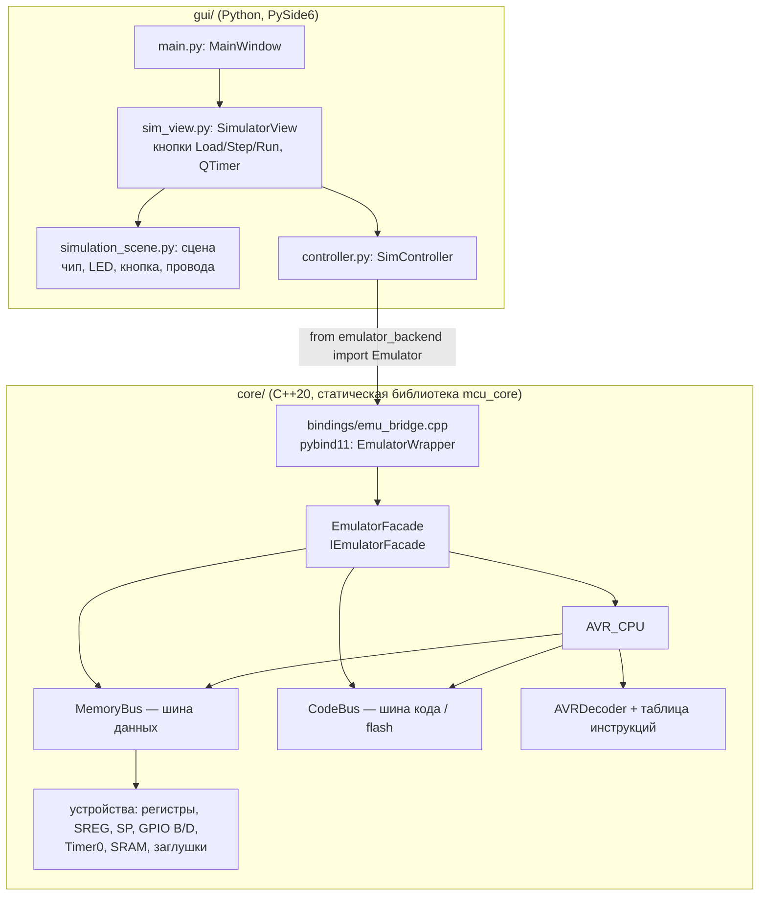
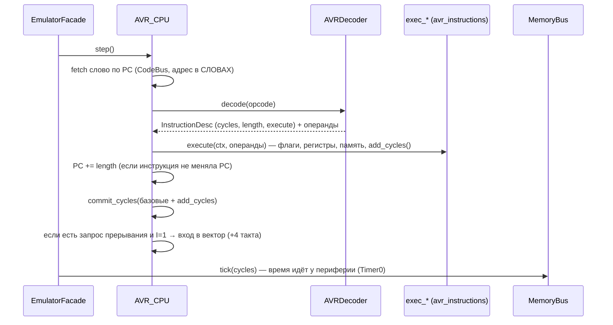

# Архитектура

Проект — эмулятор ATmega328P: ядро на C++ (`core/`), GUI на Python/PySide6 (`gui/`), тесты ядра на C++ (`tests/cpp/`).

## Слои



- **GUI** не содержит логики эмуляции: всё состояние читается через `emulator_backend.Emulator`
  (`step`, `run`, `read_memory`, `get_registers`, …).
- **`EmulatorFacade`** — единственная точка входа в ядро: владеет CPU, шинами и устройствами,
  реализует `step_instruction`, `run_for_cycles`, `read/write_data`, загрузку flash, reset.
- **`ATmega328P::create()`** собирает конкретный МК (память, карта I/O, периферия, декодер).
  Чтобы получить другой МК — писать новый класс сборки, ядро (`AVR_CPU`) переиспользуется.

## Карта каталогов `core/`

| Каталог                   | Что внутри                                                                                                                                                                                                               |
| ------------------------- | ------------------------------------------------------------------------------------------------------------------------------------------------------------------------------------------------------------------------ |
| `interfaces/Interfaces.h` | все интерфейсы: `IMemoryMapped`, `ITickable`, `IResettable`, `ICPU`, `IDataBus`, `ICodeBus`, `IInterruptSink`, `IEmulatorFacade`                                                                                         |
| `cpu/`                    | `AVR_CPU` (цикл fetch→decode→execute, стек, прерывания), `avr_instructions.*` (семантика инструкций), `avre_plus_instruction_table.cpp` (таблица mask/pattern), `AVRExecutionContext.h` (узкий интерфейс для инструкций) |
| `decoder/`                | `AVRDecoder` (справочник по 16-битному опкоду) и `decode_*` — разбор операндов                                                                                                                                           |
| `bus/`                    | `MemoryBus` (диапазон адресов → устройство, тикает периферию), `CodeBus`, `FlashDevice`, `SRAMDevice`                                                                                                                    |
| `mcu/avr/`                | `ATmega328P` (сборка МК), константы (векторы), `AVR_GPIO`                                                                                                                                                                |
| `mcu/peripherals/`        | `Timer0`, `MMIORegister`, `UnimplementedIODevice`, регистровый файл, SREG, SP, `Wire`                                                                                                                                    |
| `hex_parser/`, `loader/`  | Intel HEX → `HexImage` → `ProgramImage` (flash/EEPROM)                                                                                                                                                                   |
| `facade/`                 | `EmulatorFacade`                                                                                                                                                                                                         |
| `bindings/`               | pybind11-модуль `emulator_backend`                                                                                                                                                                                       |

## Путь одной инструкции



Главное правило времени: **число тактов считается в одном месте** (`AVR_CPU::commit_cycles`), и ровно оно
передаётся в `MemoryBus::tick`. Инструкции с переменной стоимостью (взятый переход, пропуск) вызывают
`ctx.cpu().add_cycles(n)`.

## Шина данных и карта адресов

Адреса — как в пространстве данных ATmega328P:

| Диапазон                    | Что                                                                         |
| --------------------------- | --------------------------------------------------------------------------- |
| `0x00–0x1F`                 | регистры R0–R31                                                             |
| `0x20–0xFF`                 | I/O (по умолчанию `UnimplementedIODevice`: читается 0, запись игнорируется) |
| `0x23–0x25`, `0x29–0x2B`    | GPIOB / GPIOD (PIN, DDR, PORT)                                              |
| `0x35`, `0x44–0x48`, `0x6E` | Timer0: TIFR0, TCCR0A/B, TCNT0, OCR0A/B, TIMSK0                             |
| `0x3F`, `0x41–0x42`         | EEPROM (заглушки)                                                           |
| `0x5D–0x5E`, `0x5F`         | SPL/SPH (прокси к SP в CPU), SREG                                           |
| `0x100–0x8FF`               | SRAM (2 КиБ)                                                                |

Любой другой адрес вне карты бросает `std::out_of_range`. Карта задаётся в `ATmega328P::build_memory_map`.
Регистры Timer0 разбросаны, поэтому каждый — отдельный `MMIORegister` на своём адресе, а сам `Timer0`
получает время отдельно (`MemoryBus::add_tickable`).

## Прерывания

- Периферия (Timer0) держит _уровень_ запроса: `флаг & маска` → `IInterruptSink::raise/clear_interrupt(вектор)`.
- CPU хранит набор ожидающих векторов; побеждает **меньший адрес** вектора (выше приоритет).
- Вход: сохранить PC в стек, сбросить I, перейти на вектор, аппаратный сброс флага (ack-обработчик), +4 такта.
- После `SEI`/`RETI` следующая инструкция выполняется до обработки прерывания.
- `SLEEP`: CPU стоит (1 такт на шаг), периферия идёт, просыпается по ожидающему прерыванию.

## Загрузка HEX

```
файл .hex → HexParser::parse → HexImage (адрес → байты)
          → AVRProgramLoader::load (раскладка flash 32 КиБ / EEPROM 1 КиБ) → ProgramImage
          → EmulatorFacade::load_flash_bytes → FlashDevice
```

Правила разбора: пробелы/CRLF по краям строки и пустые строки допустимы; записи 00–05 поддерживаются
(`02` — сегмент×16, `04` — старшие 16 бит адреса); любая ошибка — `HexFormatError` с номером строки и
причиной (нет `:`, нечётное число цифр, не-hex символ, длина не сходится со счётчиком, контрольная сумма).
`avr-objcopy` кладёт flash с адреса `0x000000`, EEPROM — с `0x810000`; fuse/lock (`0x82xxxx`…) загрузчик
пропускает и сообщает в `ProgramImage::warnings` (в Python — список, который возвращает `load_hex`).
EEPROM пока не эмулируется — данные из HEX отбрасываются с предупреждением.

Flash — массив байт, но CPU обращается к нему **словами** (`CodeBus::read_word(word_addr)`).
Подробнее про единицы — в [glossary.md](glossary.md).

## API Python-модуля (`emulator_backend`)

Заглушки типов — `gui/stubs/emulator_backend.pyi`.

- Запуск: `step()`, `run(cycles) -> выполненные такты`, `reset()`; `run()` **освобождает GIL**, поэтому его
  можно вызывать из рабочего потока. `stop()` (потокобезопасно) просит идущий `run()` выйти после текущей
  инструкции; `is_running()`. Пока `run()` идёт, остальные методы бросают `EmulatorBusyError`.
- Состояние: `snapshot()` (pc, sp, sreg, cycles, registers одним вызовом), `read_memory_block`,
  `read_flash`, `get_memory_map()` (регионы пространства данных).
- Ошибки (все наследуют `EmulatorError`): `IllegalInstructionError` (с опкодом и адресом),
  `HexFormatError`, `MemoryAccessError`, `EmulatorBusyError`.

## GUI (кратко)

- `main.py` — главное окно с вкладками; рабочая часть — вкладка «Симулятор» (`sim_view.py`).
- `sim_view.py` — кнопки Load/Step/Run/Reset; Run сейчас = один шаг каждые 50 мс по `QTimer` (временно).
- `simulation_scene.py` — графическая сцена: чип (`chip_item.py`), светодиод и кнопка (`interactive_items.py`),
  провода (`wire_item.py`). Состояние пинов читается из `DDRx/PORTx`, светодиод включается, если подключён
  к выходному пину с единицей. Кнопка пока не влияет на эмулятор (см. [status.md](status.md)).
- `controller.py` — тонкая обёртка над `emulator_backend.Emulator` (состояние — `snapshot()`, порты — один `read_memory_block`).
- `run_pacing.py` — `RunPacer`: реальное время → такты МК для режима Run.
